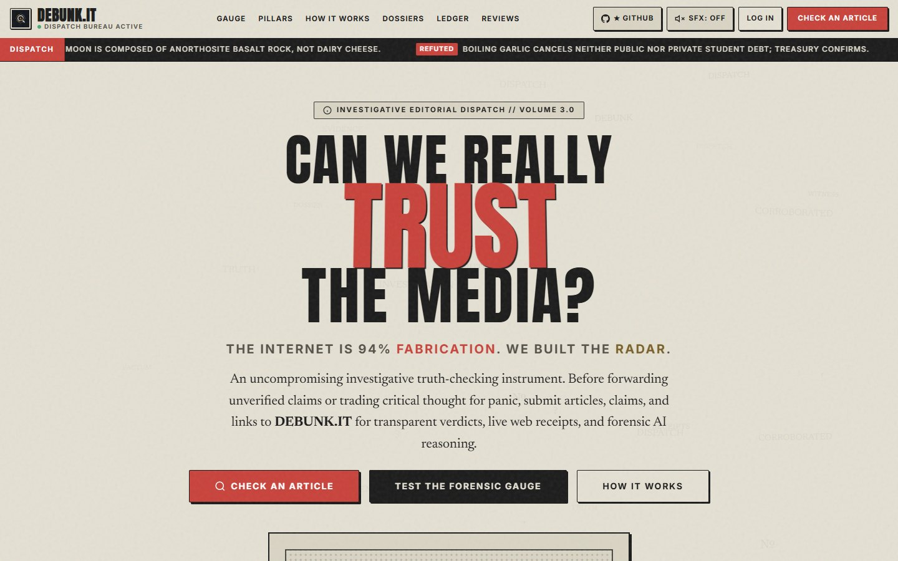
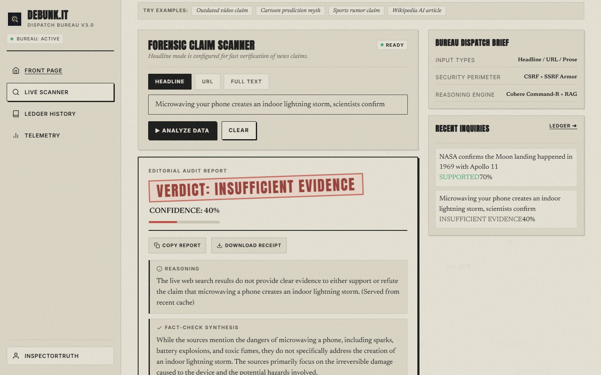
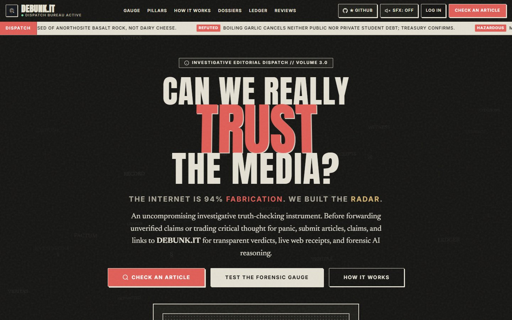
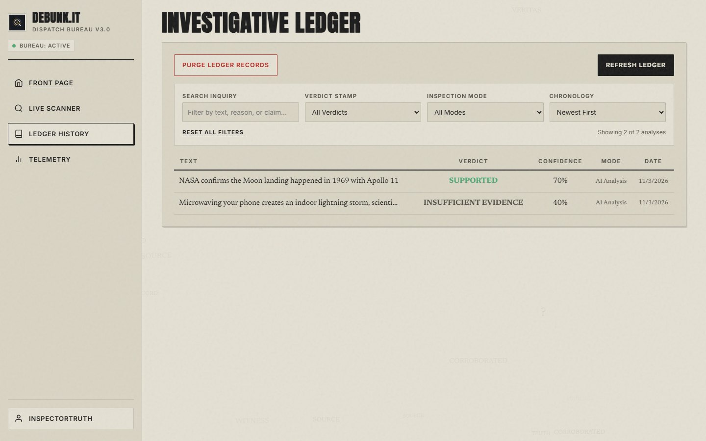
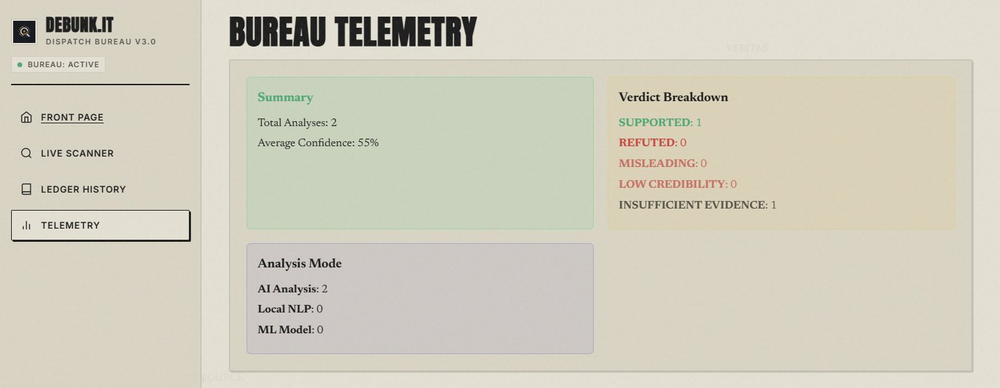
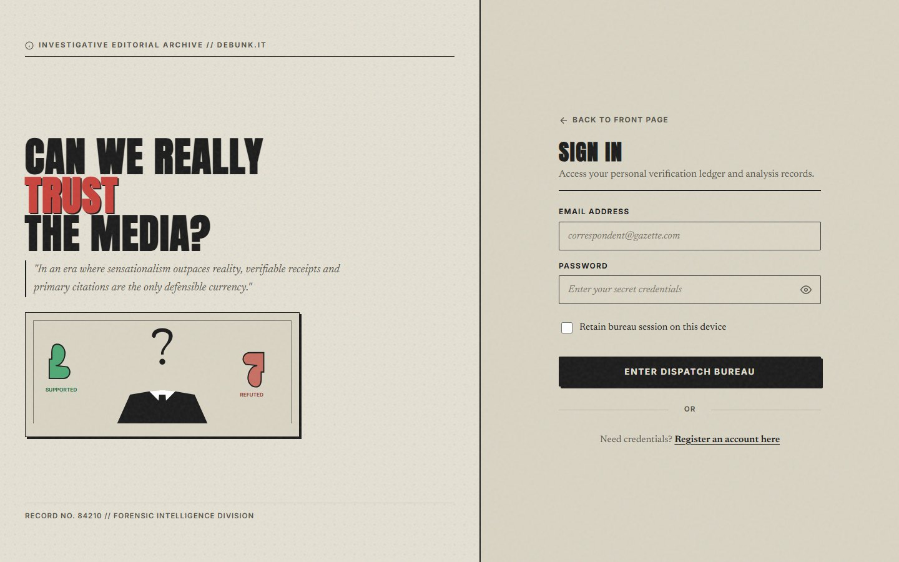
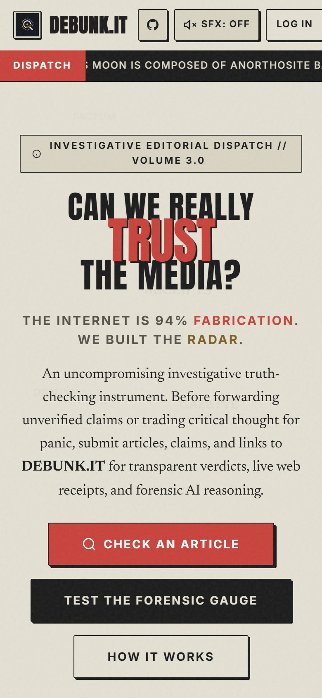
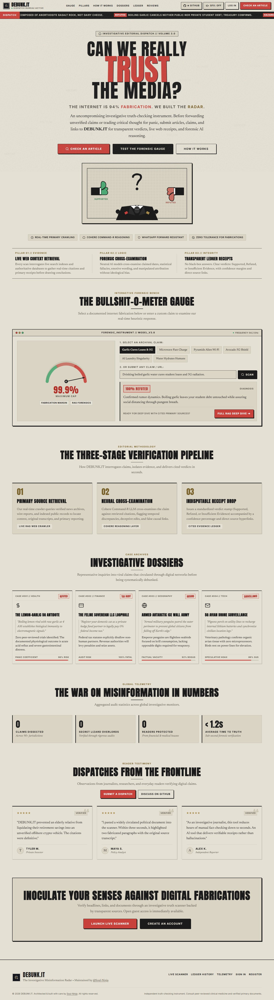
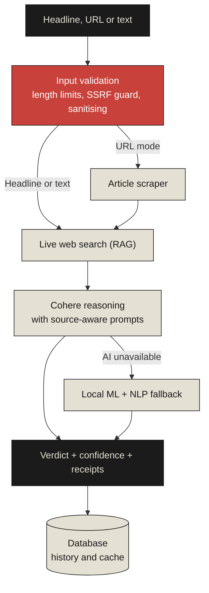

<div align="center">


# DEBUNK.IT

### Can we really trust the media? Check before you share.

AI-assisted misinformation detection with live web evidence, transparent verdicts and an editorial-dispatch interface.

<br>

[](https://debunk-it.vercel.app)
[](https://python.org)
[](https://flask.palletsprojects.com)
[](https://cohere.com)
[](tests)
[](LICENSE)

<br>



</div>

<br>

## Contents

[Live demo](#-live-demo) · [What it does](#-what-it-does) · [Screenshots](#-screenshots) · [How it works](#-how-it-works) · [Design](#-design-language) · [Quick start](#-quick-start) · [Project structure](#️-project-structure) · [Security](#-security) · [API](#-api) · [Testing](#-testing) · [Deployment](#-deployment) · [Roadmap](#-roadmap)

---

## 🚀 Live demo

**[debunk-it.vercel.app](https://debunk-it.vercel.app)**: No sign-up required to scan a claim, headline or article URL. Create a free account to maintain a searchable investigation ledger and telemetry dossier.

* **Primary Domain:** [https://debunk-it.vercel.app](https://debunk-it.vercel.app)
* **Legacy Disambiguation Route:** [https://debunkit-pi.vercel.app](https://debunkit-pi.vercel.app) (automatically 307-redirects to primary)
* **Hosting:** Vercel Global Edge Network with Python serverless execution and instant edge CDN asset delivery.

---

## 🎯 What it does

Misinformation spreads faster than fact-checking can keep up. DEBUNK.IT gives anyone a quick, evidence-backed read on a **headline**, an **article URL** or a block of **full text**, and shows its reasoning instead of just a score.

| Capability | Implementation |
|---|---|
| 🧠 **Hybrid AI pipeline** | Cohere `command-r` reasoning, a trained TF-IDF + Logistic Regression model (93% accuracy on WELFake) and a local NLP engine for instant offline fallbacks |
| 🌐 **Live web evidence (RAG)** | Multi-query DuckDuckGo live search with automated fact-check source corroboration |
| 🔗 **URL scraper** | Pulls the article body and uses it as primary evidence with SSRF protection |
| 🧾 **Transparent verdicts** | Stamp badge, confidence meter, written reasoning, cited sources and red flags |
| 📚 **History and telemetry** | Searchable ledger of past scans plus verdict, confidence and engine-mode breakdowns |
| 📋 **Export** | Copy a verification dossier or download a receipt as `.txt` |
| 💬 **Community reviews** | Visitors can read and submit peer reviews on the dispatch desk |
| 🛡️ **Security first** | CSRF protection, SSRF DNS blocking, XSS sanitisation, rate limiting, hashed passwords |
| 🌗 **Light and dark themes** | Newsprint paper by day (`#F4F1EA`), warm charcoal by night (`#141413`) |

### Verdicts

| Verdict | Meaning |
|---|---|
| ✅ `SUPPORTED` | Credible evidence confirms the central claim |
| ❌ `REFUTED` | Credible sources contradict the claim |
| ⚠️ `MISLEADING` | Partly true, but missing context, old media or misrepresented |
| 🔍 `INSUFFICIENT EVIDENCE` | Sources neither clearly confirm nor deny |
| 🚩 `LOW CREDIBILITY` | Suspicious language or weak sourcing, but not directly refutable |

---

## 📸 Screenshots

<table>
  <tr>
    <td width="50%" align="center">
      
      <br><sub><b>Live scanner</b>: verdict stamp, confidence meter and written reasoning</sub>
    </td>
    <td width="50%" align="center">
      
      <br><sub><b>Dark mode</b>: warm charcoal with the same editorial type</sub>
    </td>
  </tr>
  <tr>
    <td width="50%" align="center">
      
      <br><sub><b>Ledger history</b>: every scan, searchable and filterable</sub>
    </td>
    <td width="50%" align="center">
      
      <br><sub><b>Telemetry</b>: verdict breakdown, average confidence and engine mode</sub>
    </td>
  </tr>
  <tr>
    <td width="50%" align="center">
      
      <br><sub><b>Sign in</b>: editorial split layout with inline validation</sub>
    </td>
    <td width="50%" align="center">
      
      <br><sub><b>Mobile</b>: stacked layout with 44px touch targets</sub>
    </td>
  </tr>
</table>

<details>
<summary><b>See the full landing page</b></summary>
<br>

</details>

---

## 🔬 How it works



Results are cached per user (6 hours for URLs, 24 hours for text) so repeat checks are instant.

---

## ⚡ Quick start

```bash
git clone https://github.com/Soul-Ninja/Debunkit.git
cd Debunkit
python -m venv .venv
.venv\Scripts\activate          # macOS/Linux: source .venv/bin/activate
pip install -r requirements.txt
```

Create a `.env` file in the project root:

```env
COHERE_API_KEY=your_cohere_api_key
SECRET_KEY=a_long_random_string
DATABASE_URL=sqlite:///debunkit.db
FLASK_ENV=development
```

> A free Cohere API key is available at [cohere.com](https://cohere.com). Without one, DEBUNK.IT falls back gracefully to the local ML and NLP engines.

```bash
python debunkit_app.py
```

### Database migrations
```bash
flask db migrate -m "description"  # create a migration from model changes
flask db upgrade                   # apply pending migrations to database
```

Open **http://127.0.0.1:5000**.

---

## 🗂️ Project structure

```
Debunkit/
├── api/
│   └── index.py           Vercel serverless WSGI adapter & path-fix middleware
├── vercel.json            Vercel deployment & rewrite configuration
├── public/                Static assets optimized for Vercel Edge CDN
│   └── static/            CSS, JS, and Image mirrors for 0ms static delivery
├── debunkit_app.py        Core Flask application: views, routes and APIs
├── config.py              Development / Production / Testing configurations
├── serve.py               Waitress production server wrapper
├── Dockerfile             Container image (Gunicorn)
│
├── Core/
│   ├── ai_engine.py       Cohere reasoning & hybrid analysis pipeline
│   ├── rag_engine.py      Live search & article scraper
│   ├── nlp_engine.py      Offline heuristic & pattern engine
│   ├── database.py        SQLAlchemy database models
│   └── user_model.py      Authentication model (Flask-Login)
│
├── utils/                 validators.py (SSRF guard) · sanitizer.py (XSS prevention)
├── Template/              landing · index (scanner, ledger, telemetry) · auth · profile · settings
├── Static/                CSS · JS (landing, main, canvas) · Images
├── tests/                 Comprehensive pytest suite (86 tests)
└── docs/screenshots/      README visual documentation
```

---

## 🛠️ Tech stack

| Layer | Tools |
|---|---|
| **Hosting & Edge** | Vercel Serverless Functions (Python 3.12), Vercel Global Edge CDN |
| **Backend** | Flask 3.x, Flask-Login, Flask-Limiter, Flask-SQLAlchemy, Flask-CORS, Werkzeug |
| **AI / ML** | Cohere `command-r-08-2024`, scikit-learn (TF-IDF + Logistic Regression), DuckDuckGo search (`ddgs`), BeautifulSoup4 |
| **Frontend** | Jinja2 templates, vanilla JavaScript (ES6+), CSS custom properties, HTML5 canvas. No external UI frameworks |
| **Data** | SQLite for local/ephemeral runs, PostgreSQL via `DATABASE_URL` for persistent production |
| **Security** | CSRF tokens, SSRF IP-resolver guards, HTML sanitization, secure cookies, rate limiting |

---

## 🔐 Security

| Layer | Protection |
|---|---|
| `validators.py` | Length limits, null-byte stripping, URL scheme enforcement, **SSRF blocking** via DNS resolution |
| `sanitizer.py` | **XSS prevention**: HTML escaping, script removal, `javascript:` / `data:` blocking |
| `debunkit_app.py` | **CSRF token** required on every `POST`, `PUT`, `PATCH` and `DELETE` |
| `main.js` | Sends `X-CSRFToken`; refuses non-HTTP source URLs in the DOM |
| `config.py` | Rate limiting, password complexity rule, secure session cookies |

---

## 📡 API

| Method | Endpoint | Description |
|---|---|---|
| `POST` | `/analyze` | Run claim or article verification |
| `GET` | `/api/history` | Signed-in user's analysis history |
| `GET` | `/api/analysis/<id>` | Full analysis receipt with sources |
| `GET` | `/api/search?q=` | Search past analyses |
| `GET` | `/api/stats` | Global verdict and claim statistics |
| `POST` | `/api/clear-database` | Delete user analysis records |
| `GET` `PUT` | `/api/user/profile` | View or update profile |
| `PUT` | `/api/user/settings` | Theme, password and preferences |
| `DELETE` | `/api/user/delete` | Delete account and user data |
| `GET` `POST` | `/api/reviews` | Read or submit editorial reviews |
| `GET` | `/api/health` | Service health status |
| `GET` | `/api/ready` | Database readiness status |

---

## 🧪 Testing

```bash
pip install -r requirements-dev.txt
pytest -q
```

**86 unit and integration tests** cover:
* API responses, headers, and HTTP status codes
* Cohere AI engine integration & offline ML fallbacks
* SSRF validation (blocking localhost, private subnets, cloud metadata IPs)
* XSS sanitisation and payload filtering
* Authentication, CSRF token handling, and password complexity enforcement

**Local ML baseline:** On 1,000 held-out samples from WELFake, the TF-IDF + Logistic Regression fallback scores **~93% accuracy** at roughly **1.6 ms** per query (see [debunkit_metrics_summary.md](debunkit_metrics_summary.md)).

---

## 🌍 Deployment

### 1. Vercel (Recommended & Live Production)
The live application runs serverless on **Vercel** with global Edge CDN asset caching:
* Connect the repository to Vercel with the **Flask** application preset.
* Environment variables needed in Vercel Project Settings:
  * `SECRET_KEY`: A secure random cryptographic string
  * `COHERE_API_KEY`: Your Cohere API key
  * `FLASK_ENV`: `production`
* Automatic zero-downtime deployment triggers on every git push to `main`.

### 2. Docker & Container Hosts
```bash
docker build -t debunkit .
docker run -p 8080:8080 --env-file .env debunkit
```

### 3. Traditional WSGI / Gunicorn
```bash
gunicorn -w 4 -b 0.0.0.0:5000 debunkit_app:app
```

---

## ⚠️ Limitations

- **Not a final authority.** DEBUNK.IT is an assistant, not a replacement for human judgment.
- Breaking news, satire, AI-generated images and conflicting sources may still need manual checking.
- The local ML model detects writing patterns, not factual truth.
- Full AI analysis needs a Cohere API key; without one it falls back to local pattern analysis.
- Search quality depends on DuckDuckGo availability and can drop for very recent events.

---

## 🗺️ Roadmap

- [x] Hybrid analysis pipeline (AI + ML + NLP)
- [x] Accounts, history and telemetry
- [x] Security hardening (CSRF, SSRF, XSS, rate limiting)
- [x] Docker support and CI
- [x] Editorial redesign with light and dark themes
- [x] Signature motion layer
- [x] Vercel serverless deployment & custom domain (`debunk-it.vercel.app`)
- [ ] Browser extension
- [ ] Image and video misinformation detection
- [ ] Multilingual support
- [ ] Public API with keys

---

## 🤝 Contributing

1. Fork the repository
2. Create a branch: `git checkout -b feature/your-feature`
3. Commit: `git commit -m "feat: your feature"`
4. Push and open a Pull Request

---

<div align="center">

**MIT License** · Built by **[Soul-Ninja](https://github.com/Soul-Ninja)**

*Analyze claims before they spread.*

⭐ Star the repo if it helped you

</div>

